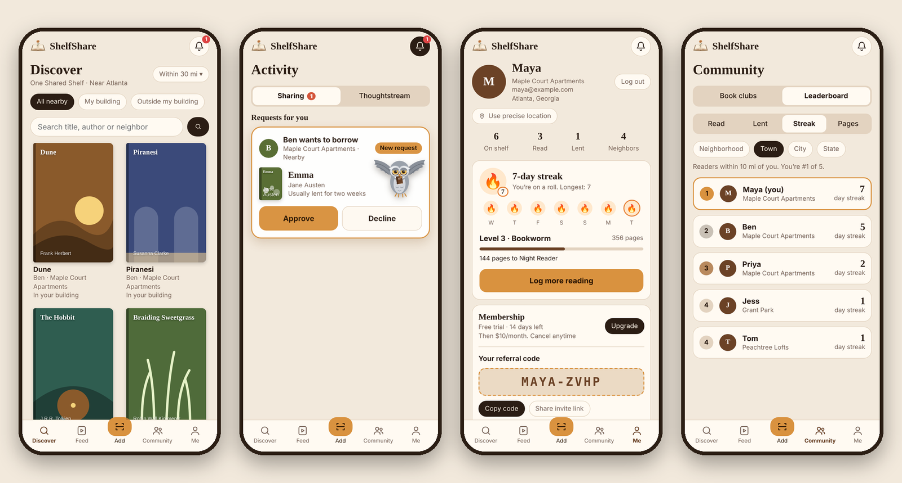
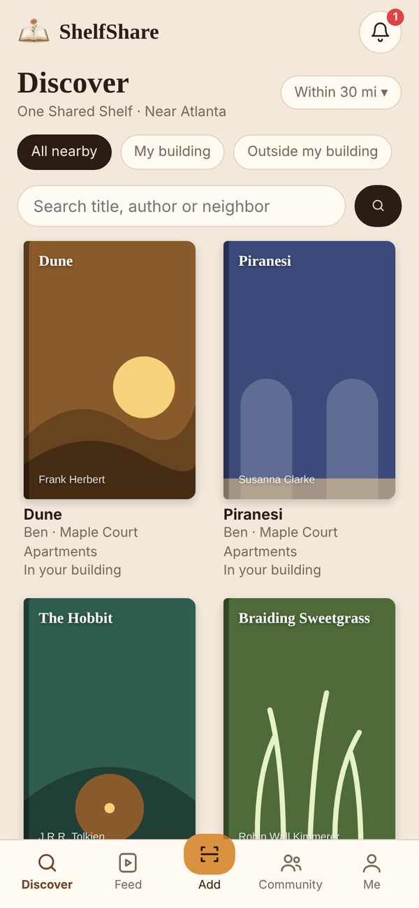
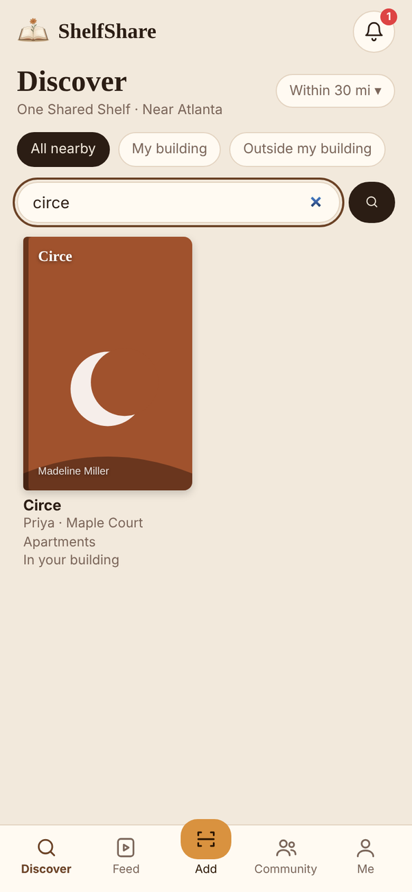
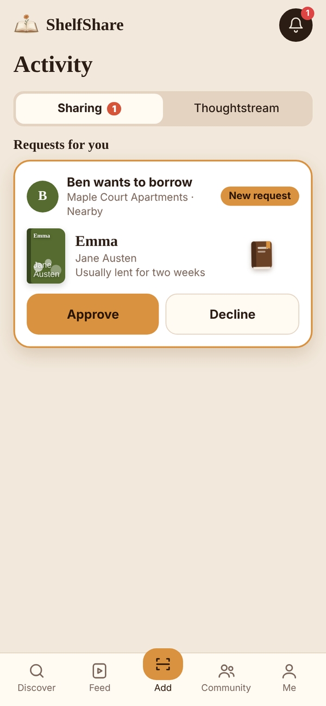
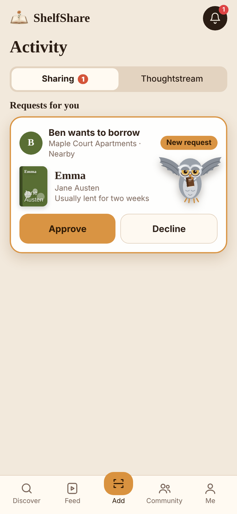
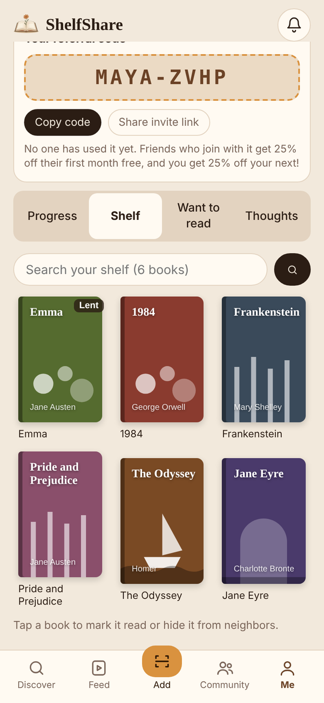
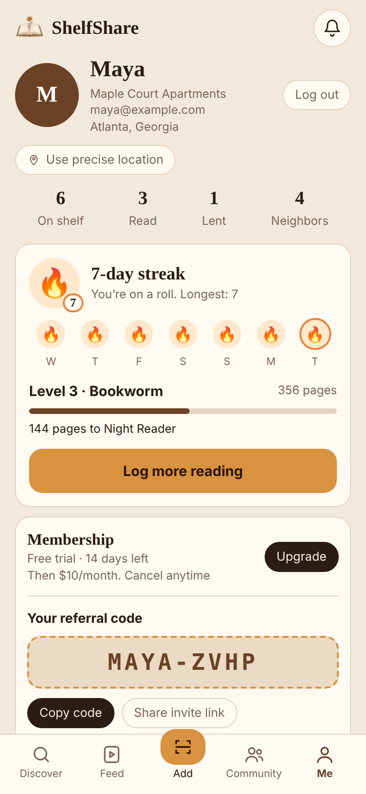
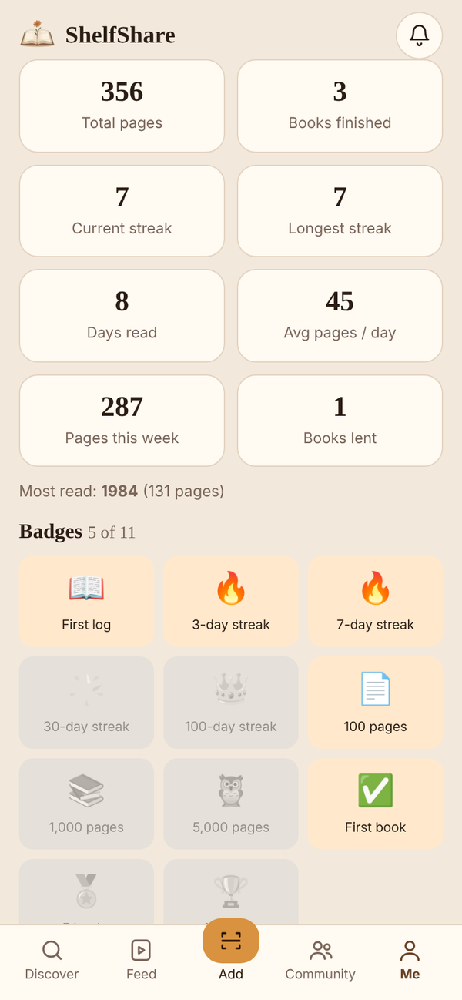
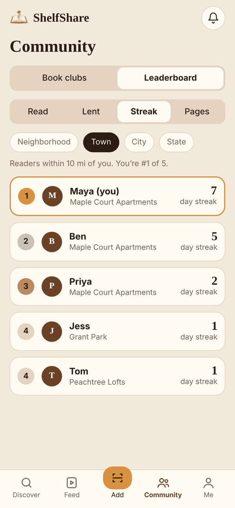

  

<h1 align="center">ShelfShare</h1>

<b>One Shared Shelf.</b> Borrow and swap books with the people in your building and neighborhood.

  

ShelfShare is a neighborhood book-lending app that I built with Claude over the 48 hours of **HackATL**. Most of us own books we have already read and want ones we have not, and our neighbors have the opposite problem. ShelfShare puts every shelf nearby in one place: scan a book to share it, find one you want, ask to borrow it, and pick it up from someone down the hall.

It runs as a single static page, with no build step and no backend server to run.

## What it does

| | |
|---|---|
| **Scan to share** | Point your camera at a barcode. ShelfShare reads the ISBN, looks the book up in Open Library and Google Books, and adds it to your shelf. If a book isn't in either catalog, add it by hand and photograph the cover. |
| **Find books nearby** | Browse and search every book within your chosen range, filtered to your own building or to everyone around you. Want something nobody has yet? Add it to your want list, and ShelfShare flags a **swap match** when a neighbor wants one of your books too. |
| **Borrow and swap** | Request a book or propose a swap. The lender approves, and a wise old owl flies in to carry the book away. Loans run two weeks and can be extended. |
| **Read together** | Neighborhood and building book clubs with chat, plus a thoughts feed where borrowers share what they think without spoilers. |
| **Build a reading habit** | Log pages to keep a daily streak, level up, and earn badges. Neighbors compete on leaderboards for books read, books lent, streak and pages. |
| **Membership** | $10 a month, with a 2 week free trial and referral codes. Payments are a demo only: nothing is charged and no card is collected. |

## Screens

<table>
  <tr>
    <td align="center" width="25%"> <b>Discover</b> Every shelf in range</td>
    <td align="center" width="25%"> <b>Search</b> By title, author or neighbor</td>
    <td align="center" width="25%"> <b>Approve</b> Lenders get a request card</td>
    <td align="center" width="25%"> <b>The owl</b> Approval, with a flourish</td>
  </tr>
  <tr>
    <td align="center" width="25%"> <b>Your shelf</b> Three-up grid with search</td>
    <td align="center" width="25%"> <b>Streaks</b> Log pages, keep the flame lit</td>
    <td align="center" width="25%"> <b>Progress</b> Stats, levels, badges</td>
    <td align="center" width="25%"> <b>Leaderboard</b> Streak, pages, reads, loans</td>
  </tr>
</table>

## How it is built

- **One file.** `index.html` holds the whole app in vanilla JavaScript, with no framework and no bundler. Only the barcode decoder in `vendor/` is separate, and it is self-hosted so scanning works on any phone.
- **Firebase, called directly.** Accounts use Firebase Authentication and data lives in Realtime Database, both over plain REST. Phones poll every 2.5 seconds to stay in sync.
- **Scanning.** The browser's native `BarcodeDetector` is used where it exists, with a WebAssembly fallback (`zxing-wasm`) elsewhere. Reads are checked against the ISBN checksum and confirmed twice before a lookup.
- **Rules do the security.** Every database write is checked by `firebase-rules.json`: you can only edit your own profile and books, only a lender can approve their own requests, and names on posts must match the writer's profile. The rules were tested against a rules evaluator with attack cases, not just the happy path.
- **Privacy by design.** Neighbors see your approximate area, never your exact location.

## Run your own

1. Create a Firebase project. Turn on **Email/Password** sign-in and create a **Realtime Database**.
2. In the database's **Rules** tab, paste `firebase-rules.json` and publish.
3. In `index.html`, set `FIREBASE_URL` and `API_KEY` at the top of the script to your project's values. The web API key is meant to be public and the rules protect the data. You can also restrict it to your site's domain in Google Cloud.
4. Put the files on GitHub Pages (or any static host) and open the site.

Files: `index.html`, `vendor/` (barcode decoder), `icons/` and `manifest.webmanifest` (logo and home-screen icon), `firebase-rules.json`.

## What is real and what is a demo

Real: accounts, scanning and lookup, requests, swaps, clubs, chat, streaks, leaderboards, and the security rules.

Demo only: **payments**. The membership page, the free trial and the referral rewards show the intended flow, but nothing is charged. A launch version would add Stripe checkout and enforce trials and referral credit on a server.

## What is next

- Real payments, with trials and referral credit enforced on a server
- Push reminders for due dates and new requests
- Direct messages between lender and borrower to arrange the handoff
- Search beyond neighbors' shelves, across the whole catalog
